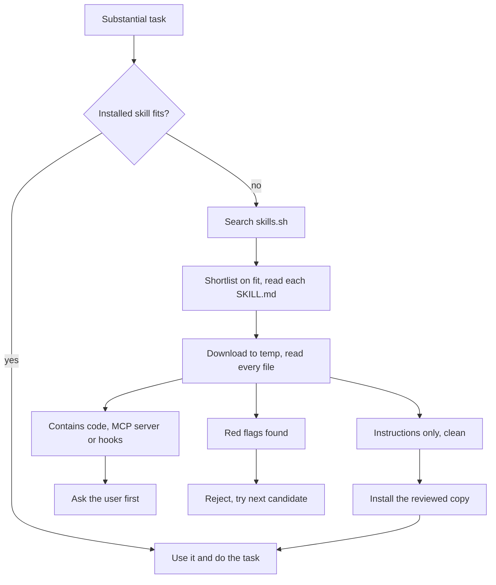

# skill-router

**Let your coding agent pick the right skill for the job, and safely fetch one when it doesn't have it.**

[](https://github.com/samarthkombli-ops/skill-router/actions/workflows/check.yml)
[](https://github.com/samarthkombli-ops/skill-router/releases)
[](LICENSE)
[](https://agentskills.io)

`skill-router` is an [Agent Skill](https://agentskills.io) for Claude Code, Codex and other
agents that support `SKILL.md`. At the start of a substantial task it:

1. **Equips the right companions for the type of work**: skills that make every task of that
   kind better, like a minimal-diff skill for any coding, design-taste and Motion skills for any
   website, or a multi-platform research skill for web research
   (see the [catalog](skills/skill-router/references/catalog.md)).
2. **Splits the task into facets** (a website: art direction, layout, motion, stack…) and checks
   the skills you already have for each one.
3. **Finds what's missing** on [skills.sh](https://skills.sh) / GitHub, preferring official
   publishers and widely adopted specialists, judged on fit rather than popularity alone, and
   takes useful side skills from the same pack.
4. **Vets every candidate** by downloading it to a temp folder and reviewing every file before
   anything is installed.
5. **Installs the essentials, offers the optional ones once**, then does your task with them and
   tells you in one line what it used.



## Install

**Claude Code: plugin** (recommended, updates with `/plugin update`)

```
/plugin marketplace add samarthkombli-ops/skill-router
/plugin install skill-router@skill-router
```

**Claude Code or Codex: skills CLI** (needs Node.js)

```bash
# Claude Code, all your projects
npx skills add samarthkombli-ops/skill-router -g -a claude-code

# Codex, all your projects
npx skills add samarthkombli-ops/skill-router -g -a codex
```

Drop `-g` to install for the current project only.

**Manual:** copy `skills/skill-router/` into `~/.claude/skills/` (Claude Code) or
`~/.codex/skills/` (Codex).

Start a new session afterwards so the agent picks up the skill.

### Why the plugin is recommended: reliable triggering

In testing, agents given a plain request ("fix the failing tests") skipped the skill on tasks
that looked small, even with a strong description. The plugin adds one **`UserPromptSubmit`
hook that only prints a one-line reminder** to use the router for substantial work (see
[`hooks/hooks.json`](hooks/hooks.json)); with it, agents invoked the router every time. It runs
nothing else.

Installed with `npx skills` instead? Add the same reminder to `~/.claude/settings.json` yourself:

```json
{
  "hooks": {
    "UserPromptSubmit": [
      { "hooks": [ { "type": "command", "timeout": 5,
        "command": "echo \"skill-router: if this message asks for any coding, website, design, video, image, writing, marketing, research, data or document work, invoke the skill-router skill before starting. Skip for pure questions and chit-chat.\"" } ] }
    ]
  }
}
```

## Use

Just work as normal. The router triggers on substantial or specialised tasks ("build a…",
"convert this…", "set up…") and stays out of the way for quick questions. You can also call it
directly: *"find the best skill for this"*, *"route this"*, or the `/skill-router` command in Claude Code
(`/skill-router:skill-router` when installed as a plugin).

Example of what you'll see:

> No installed skill covers changelogs; searching for one.
>
> Installed `stanfordspezi/spezivibe@keep-a-changelog-generator` (instruction-only, vetted) for
> the changelog.

## Safety model

Skills run with your agent's full permissions, so the router treats every download as untrusted:

- **Nothing is installed unreviewed.** Every instruction file and script is read in full in a temp
  folder; large reference data is scanned for hidden instructions, URLs and commands.
- **Instruction-only skills** (markdown only) that pass the checklist install automatically.
- **Skills with bundled scripts** (standard-library helpers inside the skill folder, every line
  read) need your yes, unless your `CLAUDE.md` / `AGENTS.md` opts in with
  `skill-router: auto-install vetted bundled scripts`.
- **System-changing skills** (package installs, binaries, MCP servers, hooks, config edits)
  always need your explicit yes, with a summary of what the code does.
- **Red flags mean rejection**: prompt-injection ("ignore previous instructions", "pre-authorized
  by the user"), reading credentials or `.env` files, sending data to hard-coded URLs, hidden
  zero-width or bidirectional Unicode characters, instructions to hide actions from you, and more.
  See [`references/vetting.md`](skills/skill-router/references/vetting.md).
- **What you reviewed is what gets installed.** The vetted copy is installed, not a fresh
  re-download.
- **Your existing skills are never overwritten**, and your project's own rules (`CLAUDE.md`,
  `AGENTS.md`) always win over any skill.

This skill is itself instruction-only: three markdown files, no code.

## Limits

- Vetting is done by the agent reading files. It raises the bar a lot, but it is not a malware
  scanner. Review skills with code yourself before saying yes or opting in.
- Search uses `npx skills find`, which needs Node.js. Without it the agent falls back to
  browsing skills.sh or GitHub.
- A skill installed mid-session may not show up in the agent's skill list until the next
  session. The router handles this by reading the new `SKILL.md` directly.

## Keeping the catalog current

The [catalog](skills/skill-router/references/catalog.md) is built from data, not hand-picked:
`python scripts/sweep.py` queries skills.sh across 25 types of work and flags copies and
lookalike repos. Outside the catalog, the router searches live.

## Security

Found a way to get an unsafe skill past vetting? Please report it privately; see
[SECURITY.md](SECURITY.md).

## Testing

See [TESTING.md](TESTING.md) for the scenarios it was tested on, including a booby-trapped
skill that tries to steal SSH keys.

## Contributing

Issues and pull requests are welcome. See [CONTRIBUTING.md](CONTRIBUTING.md). Especially useful:
new red-flag patterns you've seen in the wild, install paths for more agents, and real routing
mistakes (what you asked, what it picked, what it should have picked).

## License

[MIT](LICENSE)
