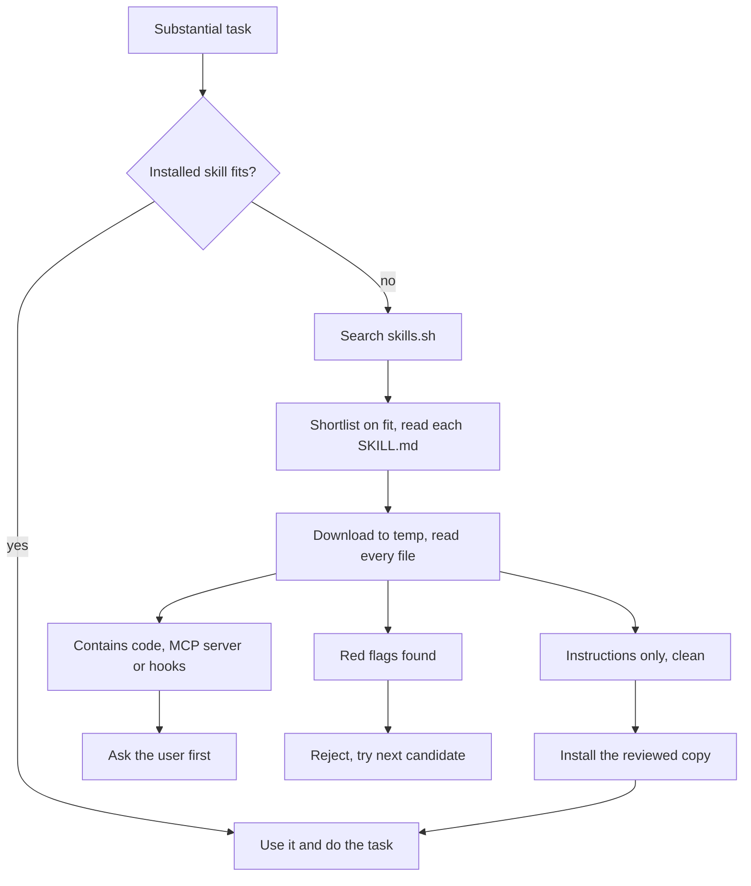

# skill-router

**Let your coding agent pick the right skill for the job, and safely fetch one when it doesn't have it.**

[](https://github.com/samarthkombli-ops/skill-router/actions/workflows/check.yml)
[](https://github.com/samarthkombli-ops/skill-router/releases)
[](LICENSE)
[](https://agentskills.io)

`skill-router` is an [Agent Skill](https://agentskills.io) for Claude Code, Codex and other
agents that support `SKILL.md`. At the start of a substantial task it:

1. **Checks the skills you already have** and uses the best fit, at no extra cost.
2. **Searches the open skills ecosystem** ([skills.sh](https://skills.sh) / GitHub) when nothing
   installed fits well, and judges results on relevance rather than popularity alone.
3. **Vets the best candidate** by downloading it to a temp folder and reading every file before
   anything is installed.
4. **Installs it and finishes your task with it**, then tells you in one line what it used.



## Install

**Claude Code: plugin** (recommended, updates with `/plugin update`)

```
/plugin marketplace add samarthkombli-ops/skill-router
/plugin install skill-router@skill-router
```

**Claude Code or Codex: skills CLI** (needs Node.js)

```bash
# Claude Code, all your projects
npx skills add samarthkombli-ops/skill-router -g -a claude-code

# Codex, all your projects
npx skills add samarthkombli-ops/skill-router -g -a codex
```

Drop `-g` to install for the current project only.

**Manual:** copy `skills/skill-router/` into `~/.claude/skills/` (Claude Code) or
`~/.codex/skills/` (Codex).

Start a new session afterwards so the agent picks up the skill.

## Use

Just work as normal. The router triggers on substantial or specialised tasks ("build a…",
"convert this…", "set up…") and stays out of the way for quick questions. You can also call it
directly: *"find the best skill for this"*, *"route this"*, or the `/skill-router` command in Claude Code
(`/skill-router:skill-router` when installed as a plugin).

Example of what you'll see:

> No installed skill covers changelogs; searching for one.
>
> Installed `stanfordspezi/spezivibe@keep-a-changelog-generator` (instruction-only, vetted) for
> the changelog.

## Safety model

Skills run with your agent's full permissions, so the router treats every download as untrusted:

- **Nothing is installed unread.** Every text file in the skill is read in full in a temp folder.
- **Instruction-only skills** (markdown only) that pass the checklist install automatically.
- **Code-bearing skills** (scripts, binaries, package installs, MCP servers, hooks) always need
  your explicit yes, with a summary of what the code does.
- **Red flags mean rejection**: prompt-injection ("ignore previous instructions", "pre-authorized
  by the user"), reading credentials or `.env` files, sending data to hard-coded URLs, hidden
  zero-width or bidirectional Unicode characters, instructions to hide actions from you, and more.
  See [`references/vetting.md`](skills/skill-router/references/vetting.md).
- **What you reviewed is what gets installed.** The vetted copy is installed, not a fresh
  re-download.
- **Your existing skills are never overwritten**, and your project's own rules (`CLAUDE.md`,
  `AGENTS.md`) always win over any skill.

This skill is itself instruction-only: two markdown files, no code.

## Limits

- Vetting is done by the agent reading files. It raises the bar a lot, but it is not a malware
  scanner. Review code-bearing skills yourself before saying yes.
- Search uses `npx skills find`, which needs Node.js. Without it the agent falls back to
  browsing skills.sh or GitHub.
- A skill installed mid-session may not show up in the agent's skill list until the next
  session. The router handles this by reading the new `SKILL.md` directly.

## Security

Found a way to get an unsafe skill past vetting? Please report it privately; see
[SECURITY.md](SECURITY.md).

## Testing

See [TESTING.md](TESTING.md) for the six scenarios it was tested on, including a booby-trapped
skill that tries to steal SSH keys.

## Contributing

Issues and pull requests are welcome. See [CONTRIBUTING.md](CONTRIBUTING.md). Especially useful:
new red-flag patterns you've seen in the wild, install paths for more agents, and real routing
mistakes (what you asked, what it picked, what it should have picked).

## License

[MIT](LICENSE)
